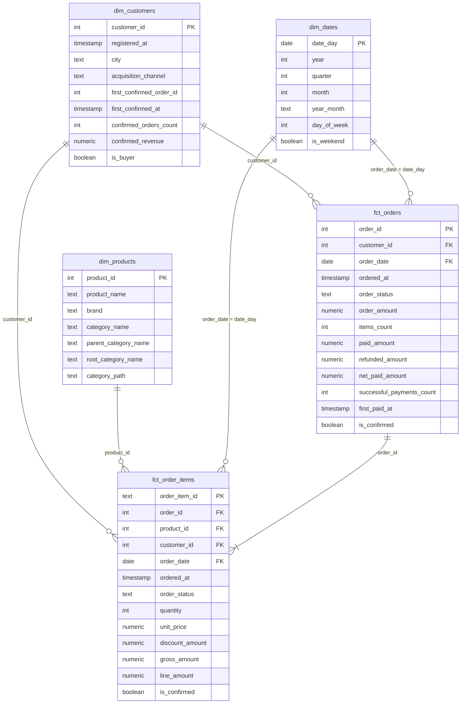
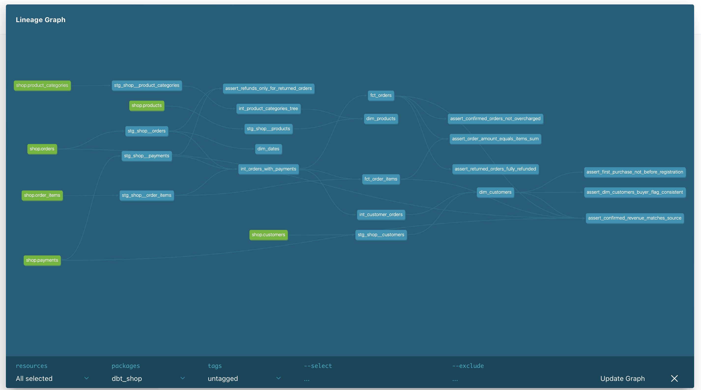

# Витрины интернет-магазина по схеме «звезда» (dbt + Greenplum)

Домашнее задание 1 курса Data Engineering. Это первый слой сквозного проекта: аналитический слой
в хранилище Greenplum. Проект продолжает семинар 5
([RKurbanova/store_hse](https://github.com/RKurbanova/store_hse), подключён как remote `course`).

```
PostgreSQL (OLTP, shop) ── loader ──► Greenplum dwh.raw ── dbt ──► analytics_staging
                                                                   analytics_intermediate
                                                                   analytics_marts   ← витрины
```

## Запуск

Нужны Git и запущенный Docker Desktop. Python, Greenplum и dbt ставить не нужно, всё работает в контейнерах.

```bash
docker compose down -v && docker compose up -d   # чистые базы и загрузка raw
docker compose logs loader                       # дождаться строки «Готово»
docker compose build dbt                         # первый раз 1–3 минуты
docker compose run --rm dbt build                # ERROR=0, WARN=1 (объяснён ниже)
```

Документация и граф lineage:

```bash
docker compose run --rm dbt docs generate
docker compose run --rm --service-ports dbt docs serve --host 0.0.0.0 --port 8080 --no-browser
# открыть http://localhost:8080
```

## Модель данных

### Звезда



### Витрины

| Витрина | Зернистость (одна строка — это…) | На какой бизнес-вопрос отвечает |
|---|---|---|
| `fct_orders` | заказ, без тестовых | Выручка и число подтверждённых покупок по дням и месяцам, средний чек по городам и каналам, оплаты, возвраты и переплаты |
| `fct_order_items` | товар в заказе | Выручка по месяцам и категориям товаров, какие бренды и товары чаще возвращают |
| `dim_customers` | клиент, включая не купивших | Доля покупателей по каналам привлечения, когда клиент сделал первую покупку, выручка на клиента по городам |
| `dim_products` | товар | Срез выручки по бренду и по категории любого уровня: `category_name`, `parent_category_name`, `root_category_name` |
| `dim_dates` | день | Группировка по году, кварталу, месяцу, дню недели, будням и выходным; дни без заказов видны как нулевые |

**Подтверждённая покупка** (`is_confirmed`) — заказ в статусе `paid`, не тестовый, с хотя бы одной
успешной оплатой. Возврат оплатой не считается. Полное определение — doc-блок `confirmed_order`
в [models/docs.md](models/docs.md).

Примеры запросов к звезде:

```sql
-- выручка по месяцам и корневым категориям
select d.year_month, p.root_category_name, sum(f.line_amount) as revenue
from analytics_marts.fct_order_items f
join analytics_marts.dim_dates d on d.date_day = f.order_date
join analytics_marts.dim_products p on p.product_id = f.product_id
where f.is_confirmed
group by 1, 2 order by 1, 2;

-- доля покупателей по каналам привлечения
select acquisition_channel, avg(is_buyer::int) as buyer_share
from analytics_marts.dim_customers group by 1 order by 2 desc;

-- средний чек по городам
select c.city, avg(o.order_amount) as avg_check
from analytics_marts.fct_orders o
join analytics_marts.dim_customers c on c.customer_id = o.customer_id
where o.is_confirmed group by 1 order by 2 desc;

-- какие бренды чаще возвращают: доля позиций в возвращённых заказах
select p.brand, avg((f.order_status = 'returned')::int) as return_share
from analytics_marts.fct_order_items f
join analytics_marts.dim_products p on p.product_id = f.product_id
where f.order_status in ('paid', 'returned')
group by 1 order by 2 desc;
```

### Хранение в Greenplum

| Витрина | Распределение и хранение | Почему |
|---|---|---|
| `fct_orders` | `distributed by (order_id)`, строчная heap-таблица | Ключ с уникальными равномерными значениями, строки ложатся на все сегменты поровну. Тот же ключ, что у `raw.orders`, `raw.order_items`, `raw.payments` и `fct_order_items`, поэтому соединение заказов с позициями идёт на каждом сегменте локально. Таблица узкая, отчёты по заказу читают почти все её колонки, так что колоночное хранение не нужно |
| `fct_order_items` | `distributed by (order_id)` + `orientation='column'` (append-optimized) | Самый большой факт. Его соединяют с `fct_orders` по `order_id`, а одинаковый ключ означает соединение без пересылки строк. Отчёты о выручке читают 3–4 колонки из 13 (`product_id`, `order_date`, `line_amount`, `is_confirmed`); колоночное хранение читает с диска только их и хорошо сжимает |
| `dim_customers` | `distributed replicated` | Маленькое измерение (40 строк): копия на каждом сегменте, JOIN с любым фактом идёт без Motion. Если клиентов станут миллионы, лучше перейти на `distributed by (customer_id)` |
| `dim_products` | `distributed replicated` | Справочник на 13 строк, как и `raw.product_categories`: соединяется с `fct_order_items` по `product_id` без пересылки |
| `dim_dates` | `distributed replicated` | 133 строки, соединяется с обоими фактами по дате |

**Почему у фактов одинаковый ключ.** В `init/greenplum/load_raw.sql` заказы, позиции и платежи
распределены по `order_id`, клиенты по `customer_id`, товары по `product_id`, категории реплицированы.
Витрины повторяют эту схему: `fct_orders` и `fct_order_items` лежат по `order_id`, и строки одного
заказа из обеих таблиц всегда находятся на одном сегменте. Если бы ключи были разными, например
`fct_order_items` лежала бы по `product_id` или `distributed randomly`, то для `join ... on order_id`
Greenplum пришлось бы перед соединением переслать строки одной из таблиц по сети между сегментами
(Redistribute Motion или Broadcast Motion), и каждый такой отчёт стоил бы дороже. Кроме того,
`product_id` даёт перекос: 13 товаров на 4 сегмента, популярный товар перегружает свой сегмент.
`customer_id` тоже плохой ключ для фактов: у клиента 1 заказов в разы больше, чем у остальных.

Проверить, что получилось:

```sql
select c.relname, pg_get_table_distributedby(c.oid) as distribution, am.amname as storage
from pg_class c
join pg_namespace n on n.oid = c.relnamespace
left join pg_am am on am.oid = c.relam
where n.nspname = 'analytics_marts' and c.relkind = 'r';
```

Ожидается: `fct_orders` — `DISTRIBUTED BY (order_id)`, heap; `fct_order_items` —
`DISTRIBUTED BY (order_id)`, `ao_column`; три `dim_*` — `DISTRIBUTED REPLICATED`, heap.

### Граф lineage



## Слои и модели

| Слой | Модели | Материализация |
|---|---|---|
| staging (`analytics_staging`) | `stg_shop__customers`, `stg_shop__products`, `stg_shop__product_categories`, `stg_shop__orders`, `stg_shop__order_items`, `stg_shop__payments` — по одной на таблицу источника, без JOIN и агрегаций, только здесь `source()` | view |
| intermediate (`analytics_intermediate`) | `int_orders_with_payments` — заказ с итогами платежей и числом товаров; `int_product_categories_tree` — дерево категорий рекурсивным CTE (выдерживает любую глубину, проверено на 4 уровнях); `int_customer_orders` — итоги и первая подтверждённая покупка клиента | view |
| marts (`analytics_marts`) | `fct_orders`, `fct_order_items`, `dim_customers`, `dim_products`, `dim_dates` — читают только `ref()` | table, `fct_order_items` — incremental |

## Тесты

- **Generic:** `unique` + `not_null` на ключ каждой модели staging, intermediate и marts;
  `relationships` от всех внешних ключей фактов к измерениям (`product_id → dim_products`,
  `customer_id → dim_customers`, `order_date → dim_dates`, `fct_order_items.order_id → fct_orders`);
  `accepted_values` на статусы заказа (staging и оба факта), статус платежа, корневые категории и день недели.
- **Свой generic-тест** [`tests/generic/non_negative.sql`](tests/generic/non_negative.sql): значение не меньше нуля.
  Применён к суммам, количествам и счётчикам: `order_amount`, `paid_amount`, `refunded_amount`, `items_count`,
  `quantity`, `unit_price`, `discount_amount`, `line_amount`, `confirmed_revenue` и другим.
- **Singular-тесты** в [`tests/`](tests/):

| Тест | Правило |
|---|---|
| `assert_order_amount_equals_items_sum` | Сумма заказа в `fct_orders` равна сумме `line_amount` его позиций в `fct_order_items` |
| `assert_confirmed_revenue_matches_source` | Число и сумма подтверждённых покупок в `fct_orders`, `fct_order_items` и `dim_customers` совпадают с посчитанными прямо по `source('shop', 'orders')` и `source('shop', 'payments')`: 106 заказов на 91 620,00 |
| `assert_returned_orders_fully_refunded` | У возвращённого заказа `net_paid_amount = 0` |
| `assert_confirmed_orders_not_overcharged` | С подтверждённого заказа не списали больше его суммы, `severity: warn` |
| `assert_first_purchase_not_before_registration` | Первая подтверждённая покупка не раньше регистрации |
| `assert_dim_customers_buyer_flag_consistent` | `is_buyer` согласован со счётчиком покупок, первой покупкой и выручкой |
| `assert_refunds_only_for_returned_orders` | Возврат бывает только у заказа в статусе `returned` (с семинара) |

### Что нашёл тест «не списали больше суммы заказа» (WARN)

`dbt build` завершается с `WARN=1` — это ожидаемо. Тест `assert_confirmed_orders_not_overcharged` находит
**заказ 113** клиента 7: сумма заказа 200,00, а успешных оплат две, по 200,00 каждая (платежи 1015 в 20:03
и 1016 в 20:04 8 марта 2026). Это **двойное списание**: с клиента взяли 400,00, переплата 200,00.
Похоже на повторную отправку платежа (двойной клик или повтор запроса без идемпотентности).

Данные под тест не подгоняли. Ошибка в источнике, а не в модели: заказ действительно оплачен,
поэтому он остаётся подтверждённой покупкой, а в выручку идёт сумма заказа (200,00), а не сумма оплат.
Тест помечен `severity: warn`: он не останавливает сборку, но проблема видна в выводе dbt и в таблице
`analytics_dbt_test__audit.assert_confirmed_orders_not_overcharged`. Что делать: передать команде платежей,
вернуть клиенту 200,00 и добавить идемпотентность при списании.

## Дополнительное задание: инкрементальная `fct_order_items`

`fct_order_items` — `materialized='incremental'`, `unique_key='order_item_id'`,
`incremental_strategy='delete+insert'` (Greenplum 7 не поддерживает `merge`). Первый запуск и
`--full-refresh` строят таблицу целиком. Обычный запуск берёт заказы, оформленные не раньше чем за
`fct_order_items_lookback_days` (по умолчанию 3) дня до самого позднего заказа в витрине, удаляет их позиции
по ключу и вставляет заново. Окно с запасом подхватывает заказы, которые изменились вскоре после оформления.

**Что такая модель пропустит:**

1. **Изменения старых заказов за пределами окна.** Если заказ месячной давности вернули (`paid → returned`),
   пришёл возврат или поздняя оплата, в `fct_order_items` останутся старые `order_status` и `is_confirmed`.
   При этом `fct_orders` пересобирается целиком и покажет новый статус, так что факты разойдутся.
   Поймают это тесты сверки `assert_order_amount_equals_items_sum` и `assert_confirmed_revenue_matches_source`.
2. **Удаления в источнике.** `delete+insert` удаляет только ключи, которые есть в новой порции. Позиция,
   удалённая из заказа (даже из заказа внутри окна), заказ, удалённый целиком или переведённый в `test`,
   так и останутся в витрине.
3. **Опоздавшие строки.** Заказ, загруженный задним числом с `ordered_at` раньше окна (импорт офлайн-продаж,
   ручная правка), не попадёт никогда.
4. **Правки позиций старых заказов**: цена, количество, скидка.

Что с этим делать: периодически (например, раз в неделю в Airflow) запускать
`dbt build --full-refresh -s fct_order_items` и/или увеличивать окно:
`dbt build --vars '{fct_order_items_lookback_days: 30}'`. Изменения в измерениях модель не пропускает:
в факте лежат только ключи, а `dim_*` пересобираются целиком.

## Самопроверка

| Проверка | Результат |
|---|---|
| `fct_orders` | 135 строк, тестовых заказов нет |
| Подтверждённые заказы / сумма | 106 / 91 620,00 |
| `fct_order_items` | 425 строк; сумма `line_amount` по подтверждённым — 91 620,00 |
| `dim_customers` | 40 строк: 29 покупателей, 11 без покупок |
| Клиент 1 | первая подтверждённая покупка — заказ 101, 9 покупок на 7 280,00 |
| Клиент 40 | `is_buyer = false`, первая покупка — null |
| `dim_products` | 13 строк; Pot A: Home > Kitchen > Cookware; Case B: Electronics > Accessories > Cases |
| Выручка по `root_category_name` | Electronics — 59 994,28, Home — 31 625,72 |
| `dim_dates` | 133 дня: 2026-03-01 … 2026-07-11 |
| Тест «не списали больше суммы» | WARN: заказ 113, двойное списание 2 × 200 |
